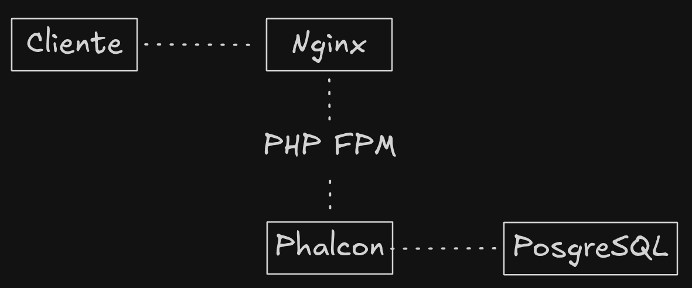

# Buy a Ticket

<h1 align="center">Buy a Ticket</h1>

<p align="center">
  <a href="#tecnologias">Tecnologias</a> •
  <a href="#getting-started">Getting Started</a> •
  <a href="#api-endpoints">API Endpoints</a> •
  <a href="#regras-de-negocio">Regras de Negócio</a>
</p>

<p align="center">
  Uma API REST para venda e reserva de ingressos, com foco no controle de concorrência e 
  na prevenção de vendas acima do limite disponível.
</p>

## Tecnologias

- PHP
- Phalcon
- PostgreSQL
- Nginx
- Docker
- Docker Compose

## Infraestrutura



## Getting Started

O projeto utiliza Docker para facilitar a configuração e a execução do ambiente local. 
A infraestrutura é definida no arquivo `docker-compose.yml`, que configura os serviços 
necessários para executar a aplicação, incluindo a API, o banco de dados e o Nginx.

### Pré-requisitos

Para executar o projeto, você precisa ter instalado:

- [Docker](https://www.docker.com/)
- [Docker Compose](https://docs.docker.com/compose/)

### Clonando o repositório

Clone o repositório e acesse o diretório do projeto:

```bash
git clone https://github.com/Edmar-Sousa/buy-a-ticket.git
cd buy-a-ticket
```

### Configurando as variáveis de ambiente

Utilize o arquivo `.env.exemplo` como referência para configurar as variáveis 
de ambiente do projeto. Caso necessário, crie um arquivo `.env` com 
as configurações abaixo.

```dotenv
DB_HOST=db
DB_USER=buy-a-ticket
DB_PASS=buy-a-ticket
DB_PORT=5432
DB_DATABASE=buy-a-ticket
```

Essas variáveis são utilizadas para configurar a conexão da 
API com o PostgreSQL por meio do `docker-compose.yml`.

> **Nota:** verifique se o nome do arquivo de exemplo corresponde ao existente no repositório e se o Docker Compose está configurado para carregar as variáveis do arquivo `.env`.

### Iniciando o projeto

Na raiz do projeto, execute:

```bash
docker-compose up --build
```

Esse comando constrói as imagens necessárias, quando aplicável, e inicia os serviços definidos no Docker Compose.

Para encerrar os serviços, pressione `Ctrl + C`. Para remover os contêineres, execute:

```bash
docker-compose down
```

## API Endpoints

A API disponibiliza quatro endpoints para criação de reservas, consulta e reinicialização do lote e confirmação de pagamentos.

| Método | Endpoint | Descrição |
|---|---|---|
| `POST` | `/reservations` | Cria uma reserva de ingressos. |
| `GET` | `/batch` | Consulta a quantidade de ingressos disponíveis e vendidos. |
| `POST` | `/batch/reset` | Reinicializa o lote. |
| `POST` | `/webhook/payment` | Processa a confirmação ou a falha de um pagamento. |

### `POST /reservations`

Cria uma reserva de ingressos. Cada CPF pode ter, no máximo, dois ingressos reservados ou vendidos.

**Requisição**

```json
{
  "cpf": "12345678900",
  "quantity": 1
}
```

**Respostas**

**`201 Created` — Reserva criada**

```json
{
  "reservation_id": "uuid",
  "cpf": "12345678900",
  "quantity": 1,
  "status": "RESERVED",
  "expires_at": "2026-07-14T15:04:05Z"
}
```

**`409 Conflict` — Lote esgotado**

```json
{
  "error": "SOLD_OUT"
}
```

**`422 Unprocessable Entity` — Limite por CPF excedido**

```json
{
  "error": "CPF_LIMIT_EXCEEDED"
}
```

### `GET /batch`

Consulta a quantidade total de ingressos, a quantidade vendida e a quantidade disponível no lote.

**Resposta**

```json
{
  "total": 100,
  "sold": 0,
  "available": 100
}
```

### `POST /batch/reset`

Reinicializa o lote para seu estado padrão, com 100 ingressos disponíveis e nenhum ingresso vendido.

**Resposta**

```json
{
  "total": 100,
  "sold": 0,
  "available": 100
}
```

> **Atenção:** a operação de reset deve ser utilizada com cuidado, especialmente em ambientes com reservas ou pagamentos em andamento.

### `POST /webhook/payment`

Recebe a atualização do status de pagamento de uma reserva.

O campo `status` aceita os valores `SUCCESS` e `FAILED`.

**Requisição**

```json
{
  "reservation_id": "uuid",
  "status": "SUCCESS"
}
```

**Respostas**

**`200 OK` — Pagamento confirmado**

Quando o pagamento é confirmado, a reserva passa para o status `SOLD`.

```json
{
  "reservation_id": "uuid",
  "status": "SOLD"
}
```

**`200 OK` — Pagamento não realizado**

Quando o pagamento falha, a reserva passa para o status `RELEASED`.

```json
{
  "reservation_id": "uuid",
  "status": "RELEASED"
}
```

**`410 Gone` — Reserva expirada**

```json
{
  "error": "RESERVATION_EXPIRED"
}
```

## Regras de Negócio

- **Limite do lote:** o lote contém 100 ingressos. A quantidade vendida não pode ultrapassar esse limite.
- **Confirmação de pagamento:** a criação de uma reserva não confirma a venda. A venda é confirmada pelo webhook quando o status do pagamento é `SUCCESS`.
- **Expiração de reservas:** as reservas expiram após cinco minutos. Os ingressos associados a reservas expiradas devem voltar a ficar disponíveis.
- **Limite por CPF:** cada CPF pode reservar ou comprar, no máximo, dois ingressos. O limite considera conjuntamente as reservas e as vendas.
- **Controle de concorrência:** as operações devem impedir que requisições simultâneas reservem ou vendam mais ingressos do que o lote disponibiliza.

## Referência

O projeto foi proposto como um desafio da Codecon. O repositório original pode ser consultado em:

[Codecon — versus-erick-wendel](https://github.com/codecon-dev/versus-erick-wendel)

## Autor

**Edmar Sousa**

[](https://www.linkedin.com/in/edmar-sousa-9666b0201/)

[](https://github.com/Edmar-Sousa)
